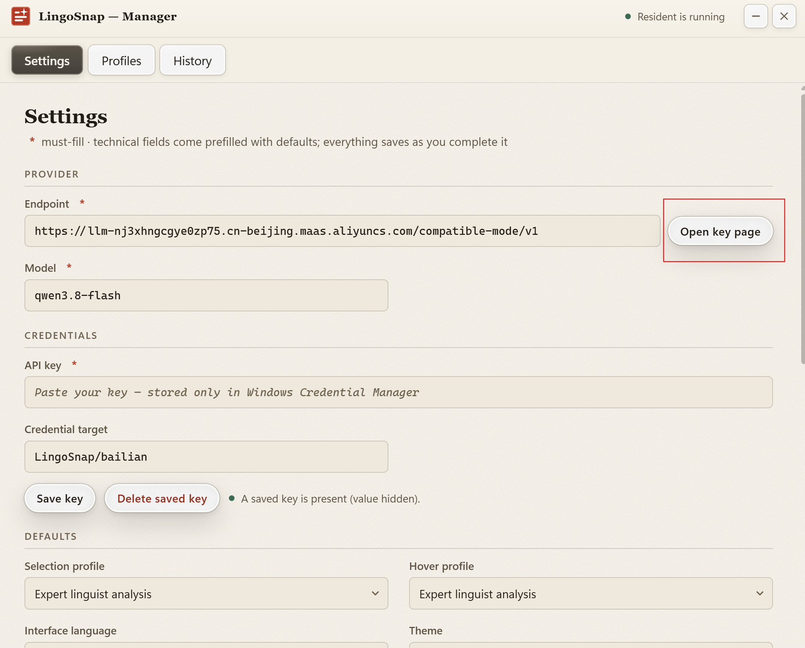
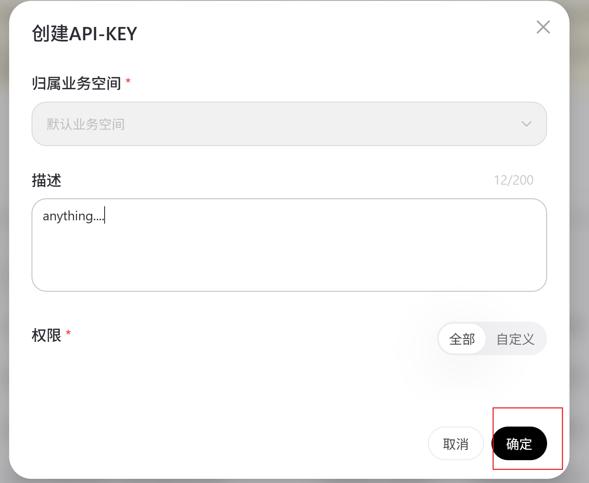
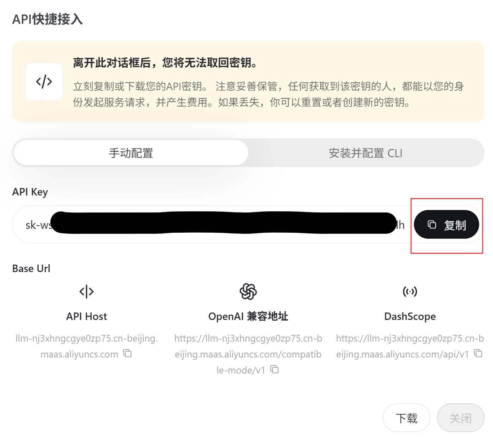
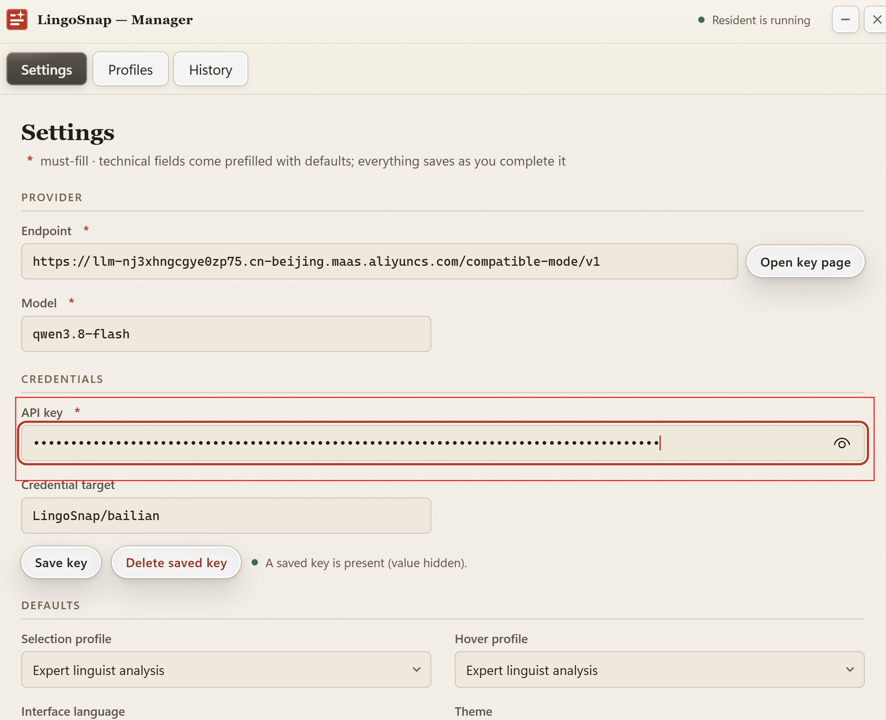
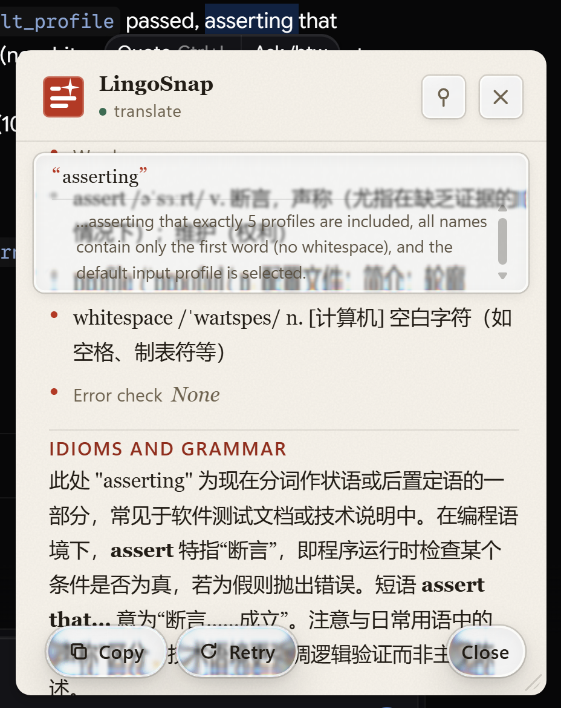

# LingoSnap

[English](README.en.md)

LingoSnap 是一款超轻量、原生的 Windows x64 智能 AI 文本处理工具与桌面生产力工作台。在屏幕上的任何位置——无论是代码编辑器、网页浏览器、PDF 阅读器还是办公套件中，只需选中文本、鼠标悬停或呼出内嵌卡片，即可获得由大语言模型（LLM）驱动的即时文本处理与深度解析（学术写作润色、代码缺陷分析、百科概念速览、语言学双语精析及丰富的自定义提示词工作流），并在不抢占焦点的紧凑浮动弹窗中流式呈现。

LingoSnap 在设计之初便将“轻量低耗”与“隐私保护”作为核心原则，后台常驻程序完全基于原生 Rust 和 Win32 构建。界面提供两种可随时切换的外观：采用现代化纸质与毛玻璃质感的 **“抄本”（Fair Copy）** 界面（配备独立的 WebView2 伴随进程，支持暗色/亮色主题），以及极简的原生 Win32 **“经典”（Classic）** 弹窗。管理器仅在打开时运行，关闭后彻底释放资源。

---

## 核心特性

- **上下文感知文本提取**：在划词或悬停时，自动提取目标文本及其所在的完整上下文（优先使用 UI Automation，自动回退到剪贴板或局部内存 Windows OCR），确保大模型能够精准消歧并理解真实语境。
- **丰富的内置与自定义处理模式**：
  - **雅思 9 分写作导师**（中英双语）：将输入文本重写润色为符合雅思 7 分以上学术标准的英语句子，并逐条阐述修改原因（词汇搭配、语域风格、衔接连贯等）。
  - **程序代码专家**：解析代码片段、定位潜在缺陷、逐行解读并说明整体架构意图。
  - **Wiki 风格解析**：客观、中立的百科全书式背景知识与概念速览。
  - **语言学家精析**（中英双语）：以规范 Markdown 结构化输出翻译、国际音标（IPA）重点生词解析、语法与常见短语、拼写与语法纠错及选词剖析。
  - **自定义配置档**：支持自由创建和排序专属提示词，灵活调节温度（Temperature）与 Token 上限，满足任何文本处理场景。
- **免打扰浮动弹窗**：弹窗浮动于当前工作界面之上，绝不抢占键盘焦点，不打断您的阅读与打字流。支持图钉置顶、流式打字机动画以及一键复制。
- **极致轻量与严苛隐私保护**：
  - **无 Electron 或后台常驻 WebView 臃肿包袱**：后台常驻程序为极简原生进程（目标空闲内存占用 `<20 MiB`）。现代 UI 伴随进程按需调用，闲置时自动休眠或退出，释放所有内存。
  - **安全凭据存储**：API Key 保存在 Windows 凭据管理器或环境变量中，绝不写入明文配置文件、日志或历史记录。
  - **零截图落盘**：OCR 仅在内存临时缓冲区截取最小必要区域，绝不向磁盘写入任何截图。
  - **保护剪贴板**：自动划词/悬停提取时，会自动暂存并在操作完成后完整还原系统剪贴板原有内容。
  - **本地历史记录**：保存在本地轻量 SQLite 数据库中，仅保留最新的 1,000 条记录，关闭后立即断开数据库连接。

---

## 默认快捷键

| 操作 | 默认快捷键 | 说明 |
|---|---|---|
| **划词处理** | `Ctrl + Shift + T` | 对当前选中的文本使用当前配置档执行分析与处理 |
| **悬停处理** | `Ctrl + Shift + H` | 开启或关闭鼠标指针悬停自动识别与处理（默认关闭） |
| **手动查询** | `Ctrl + Shift + Space` | 呼出输入卡片，可直接键入或粘贴文本，按回车或点击配置档分析 |
| **轮换配置档** | `Ctrl + Alt + P` | 快速切换不同的文本处理配置档 |
| **暂停 / 恢复** | `Ctrl + Shift + P` | 临时暂停或恢复常驻全局快捷键 |

*所有快捷键均可在管理器“设置”页中自由自定义或禁用。*

---

## 安装与启动

1. 从 GitHub Releases 下载最新版本的 `lingosnap-x64-r*.zip` 压缩包。
2. 解压到任意具有写权限的固定目录（例如 `D:\Tools\LingoSnap` 或 `C:\Program Files\LingoSnap`，亦可直接解压在当前文件夹）。
3. 运行 `lingosnap-manager.exe` 配置您的 API 地址与密钥（详细配置见下一节）。
4. 运行 `lingosnap-resident.exe`，系统托盘右下角将出现程序图标。

> [!NOTE]
> 由于预览版未购买昂贵商业代码签名证书，Windows SmartScreen 可能会弹出未知应用安全提示，点击“仍要运行”即可。用户配置和历史数据存放在 `%LOCALAPPDATA%\LingoSnap`。

---

## 填写 API 地址与密钥

LingoSnap 支持任何兼容 OpenAI Chat Completions 协议的模型服务。为方便国内用户快速上手，程序内置了阿里云百炼（Bailian）配置，并无缝支持 OpenAI、DeepSeek、月之暗面（Moonshot）、硅基流动（SiliconFlow）以及本地模型（如 Ollama、vLLM）。

### 国内快速上手：使用阿里云百炼（推荐）

阿里云百炼平台为用户和常用 Flash 系列模型（如 `qwen3.8-flash`）提供了充足的免费额度。

1. 打开 `lingosnap-manager.exe`，切换到**设置**页，点击 API 地址右侧的 **“打开密钥页面”**（Open key page）按钮，将自动打开阿里云百炼 API Key 管理控制台。

   

2. 登录阿里云账号（未实名认证需按提示完成实名），点击 **“创建 API-Key”**。

   
   

3. 复制生成的 API Key 字符串。

   

4. 返回 LingoSnap 管理器，将密钥粘贴到 **API key** 输入框中，点击 **“保存密钥”**（配置将自动生效）。

   

5. **免费额度查询与防扣费设置**：
   - 可以在 [百炼免费额度控制台](https://bailian.console.aliyun.com/cn-beijing/costing-balance/free-quota) 查看各模型的剩余免费 Token。
   - > [!IMPORTANT]
     > 强烈建议在阿里云费用与成本设置中开启 **“用完即停”** 功能，防止免费额度耗尽后产生未预期的按量扣费。

   

6. **选择与切换模型**：
   - 在百炼模型广场中挑选支持的模型（例如 `qwen3.8-flash` 等轻快实惠模型），复制其 **“模型 Code”**，粘贴至管理器的 **“模型”** 输入框中保存即可。

   

7. **验证效果**：
   - 在任意应用程序中选中一段文字（或按下快捷键），屏幕上将浮现配置档选择器；点击模式后立刻流式生成解析卡片。

   
   

---

### 自定义 OpenAI 兼容服务商

若您使用 OpenAI、DeepSeek 或其他兼容服务商：

1. 打开 `lingosnap-manager.exe`，进入**设置**页。
2. 在 **API 地址** 中填入服务商的基础地址，例如：
   ```text
   https://api.openai.com/v1
   ```
   > [!TIP]
   > 纯域名地址（如 `https://api.openai.com`）和以 `/v1` 结尾的地址均可。**请勿**手动追加 `/chat/completions`，程序在发起请求时会自动补齐路由。
3. 在 **模型** 中填入对应的模型标识（例如 `gpt-4o-mini`、`deepseek-chat`）。
4. 在 **API key** 中粘贴服务商密钥，点击 **保存密钥**。
5. 重启 `lingosnap-resident.exe`（或在托盘菜单中切换暂停/恢复）使配置生效。

#### 备选方案：环境变量
如果不希望将密钥写入凭据管理器，也可通过设置系统环境变量传入。常驻程序按以下优先级读取：
1. `OPENAI_API_KEY`
2. `LINGOSNAP_OPENAI_API_KEY`
3. Windows 凭据管理器目标（默认为 `LingoSnap/bailian` 或 `LingoSnap/OpenAI`）

---

## 验证配置是否成功

在任意应用程序中选中一段文字，如果配置正确，屏幕上会立刻浮现选择器，选择后出现流式生成的解析卡片：
- **正常出现流式文字**：说明地址、模型名称与 API 密钥均配置正确。
- **提示 `Provider authentication failed`**：API Key 无效、已过期或无权调用该模型，请检查密钥是否正确复制。
- **提示 `Provider connection failed`**：网络无法连接到目标地址，请检查网络连接、地址拼写或系统代理设置。

---

## 实用进阶功能

### 1. 调整配置档顺序（常用项快捷直达）
在管理器的 **“配置档”（Profiles）** 页面或 **“设置”（Settings）** 页面，可以通过拖拽直接调整配置档的先后顺序：
- **划词选择器优先级**：排在前面的配置档会优先出现在划词悬停后的快捷工具栏上。
- **手动查询弹窗联动**：按下快捷键 `Ctrl + Shift + Space` 唤起手动查询弹窗时，按钮栏将自动展示**排名前 5 个**的常用配置档（以精简首词呈现），方便随时一键切换。

### 2. 开机自启动（强烈推荐开启）
在管理器的 **“设置”** 页面中开启 **“开机启动”（Start with Windows）**：
- **极低内存占用**：LingoSnap 后台常驻核心完全基于原生 Rust 和 Win32 消息循环构建，**绝无 Electron 或后台常驻 WebView 的内存包袱**。空闲工作集内存通常 `< 20 MiB`（甚至低至 `10 MiB` 以下），零 CPU 轮询占用。
- **随用随唤**：现代 Fair Copy 界面按需调用、闲置自动休眠退出，完全不影响系统开机与日常工作流性能，极力推荐常驻开启。

### 3. 参考内置模板，轻松定制专属配置档
在管理器的 **“配置档”** 页面中点击任意现有配置档（如“语言学家分析”、“雅思 9 分写作导师”或“程序代码专家”）：
- **学习提示词范式**：可直接查看官方预设的系统提示词（System Prompt）、用户模版（User Template）以及 Markdown 结构化输出规范。
- **创建专属工具**：点击 **“新建配置档”**，仿照内置范例即可定制属于您的学术论文润色、商务邮件草拟、代码逐行审查、行业术语对照或任意场景文本处理工具，并能自由调节温度（Temperature）与最大 Token 数量。

### 4. 浏览本地历史记录，温故而知新
在管理器的 **“历史记录”（History）** 页面中：
- **随时复盘回溯**：过往划词、悬停以及手动查询的所有原文、上下文与大模型生成结果均被完好保存。
- **灵活检索与复用**：支持按日期筛选、按配置档归类以及全文关键字快速搜索，每条记录均支持重新执行处理与一键复制，非常适合作为文本回顾、灵感库或学习积累本进行定期复盘。
- **隐私离线存储**：历史记录纯本地存储在轻量 SQLite 数据库中（默认自动滚动保留最新 1,000 条），不经过任何第三方云端。

---

## ☕ 请作者喝一杯咖啡

如果 LingoSnap 帮到了您的日常阅读、学习或工作，欢迎请作者喝一杯咖啡，支持软件的持续打磨与维护！

| 微信支付 | 支付宝 |
| :---: | :---: |
|  |  |

---

## 详细文档

- [环境与构建说明 (SETUP.md)](docs/SETUP.md)：详细安装、工具链与环境说明。
- [完整快捷键指南 (HOTKEYS.md)](docs/HOTKEYS.md)：快捷键行为与冲突排查。
- [提取回退机制 (FALLBACKS.md)](docs/FALLBACKS.md)：UI Automation、剪贴板与 OCR 协同原理。
- [隐私与安全说明 (PRIVACY.md)](docs/PRIVACY.md)：凭据安全、零截图落盘与剪贴板完整性。
- [疑难解答 (TROUBLESHOOTING.md)](docs/TROUBLESHOOTING.md)：常见错误码与解决方案。
- [质量验证标准 (VERIFICATION.md)](docs/VERIFICATION.md)：测试门禁、Clippy 规范与内存压测标准。
- [WebView2 内存报告 (WEBVIEW_MEMORY.md)](docs/WEBVIEW_MEMORY.md)：现代抄本 UI 性能与内存优化实测数据。
