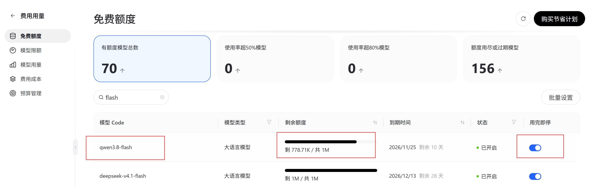
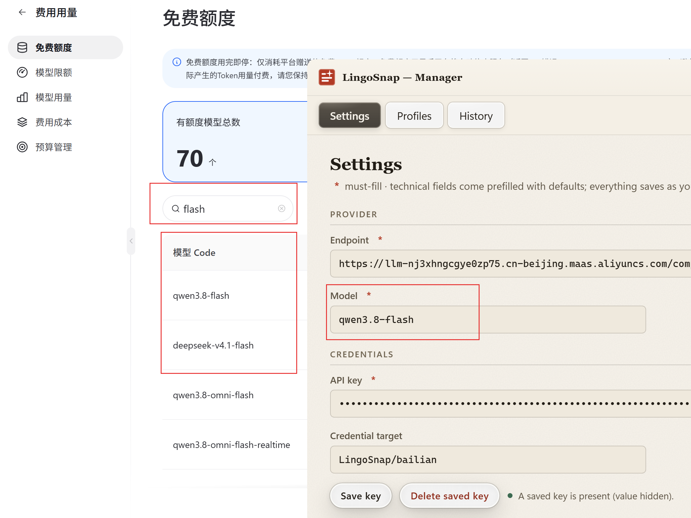

# LingoSnap

[简体中文](README.zh-CN.md)

LingoSnap is an ultralight, native Windows x64 linguistic assistant and text-processing software. Select or hover over text anywhere on your screen — across IDEs, web browsers, PDF readers, and office documents — to instantly receive structured, LLM-powered linguistic analysis (bilingual translation, detailed vocabulary breakdowns, grammar & idiom explanations, academic writing polish, and code explanation) streamed into a non-intrusive floating popup.

Designed from the ground up to be featherlight and privacy-conscious, LingoSnap keeps its background resident purely native (Rust + Win32). It features a modular dual-skin presentation: a modern, paper-like **Fair Copy** interface with liquid-glass accents and dark/light themes (powered by an on-demand companion process), alongside a lightweight **Classic** native Win32 popup. The manager runs strictly on demand.

---

## Key Features

- **Context-Aware Linguistic Processing**: Extracts both target text and its surrounding sentence context (via UI Automation, with automatic fallbacks to clipboard and bounded Windows OCR) so the LLM disambiguates meaning accurately.
- **Rich Built-in & Custom Linguistic Profiles**:
  - **Expert Linguist Analysis** (English & Chinese): Structured Markdown with translations, phonetic IPA vocabulary, grammar/idiom usage, spelling/grammar error correction, and translation nuance explanations.
  - **IELTS Writing Instructor** (English & Chinese): Academic English sentence polish (Band 7+) with concrete improvement rationales.
  - **Wiki Explanation**: Encyclopedic background and factual context summary.
  - **Code Specialist**: Code snippet breakdown, flaw identification, and logic explanations.
  - **Custom Profiles**: Create and order custom prompts with flexible temperature and token limits.
- **Non-Intrusive Floating Popup**: Floats directly above your current workspace without stealing keyboard focus or disrupting your workflow. Supports pinning, streaming output, and one-click copying.
- **Privacy & Lightweight by Design**:
  - **No Electron or background WebView bloat**: The resident runs as a tiny native background service (<20 MiB idle memory target). The WebView2 UI companion is invoked on demand and parks/exits automatically when idle.
  - **Secure Credentials**: API keys are securely stored in Windows Credential Manager or environment variables — never saved to configuration files, logs, or history.
  - **Zero Screenshot Storage**: OCR uses only a temporary, bounded in-memory buffer; no screenshots are ever written to disk.
  - **Clipboard Preservation**: User clipboard contents are safely preserved and restored during text capture.
  - **Local History**: Stored in a local SQLite database capped to the newest 1,000 entries.

---

## Default Hotkeys

| Action | Shortcut | Description |
|---|---|---|
| **Selection Translate** | `Ctrl + Shift + T` | Process currently selected text using the active profile |
| **Hover Translate** | `Ctrl + Shift + H` | Toggle automatic hover inspection under mouse pointer |
| **Manual Query** | `Ctrl + Shift + Space` | Open an input window to type or paste text, then choose a profile |
| **Cycle Profiles** | `Ctrl + Alt + P` | Cycle through configured linguistic profiles |
| **Pause / Resume** | `Ctrl + Shift + P` | Temporarily pause or resume global resident hotkeys |

*All hotkeys can be customized or disabled in Manager Settings.*

---

## Installation

1. Download the latest `lingosnap-x64-r*.zip` release archive from GitHub.
2. Extract the archive into a permanent writable folder (e.g., `D:\Tools\LingoSnap` or `C:\Program Files\LingoSnap`).
3. Run `lingosnap-manager.exe` to configure your API endpoint and key.
4. Run `lingosnap-resident.exe`. Its icon will appear in the Windows system tray.

> [!NOTE]
> Windows SmartScreen may show an untrusted binary prompt because preview builds are unsigned. User settings and history are stored safely under `%LOCALAPPDATA%\LingoSnap`.

---

## Setup & API Configuration

LingoSnap connects to any OpenAI-compatible Chat Completions API. It ships pre-configured with Alibaba Cloud Bailian (阿里云百炼) defaults for convenient out-of-the-box use in China, and works seamlessly with OpenAI, DeepSeek, Moonshot, SiliconFlow, or local models (e.g., Ollama, vLLM).

### Quick Start with Alibaba Cloud Bailian (Recommended for China)

Alibaba Cloud Bailian provides generous free quotas for fast flash models (such as `qwen3.8-flash`).

1. Open `lingosnap-manager.exe`, go to the **Settings** page, and click **Open key page** next to the Endpoint field to navigate to the Bailian API-Key console.

   

2. Sign in or complete real-name verification if prompted, then click **Create API-Key** (创建 API-Key).

   
   

3. Copy your generated API Key.

   

4. Return to LingoSnap Manager, paste the key into the **API key** field, click **Save key**, then click **Save settings**.

   

5. **Quota Protection & Models**:
   - Check your free quota balance on the [Bailian Free Quota Page](https://bailian.console.aliyun.com/cn-beijing/costing-balance/free-quota).
   - > [!IMPORTANT]
     > Ensure the **"用完即停" (Stop when quota exceeded)** switch is turned **ON** in your Alibaba Cloud billing settings to prevent unintended charges once free quotas expire.

   

6. **Select Model**:
   - In the Bailian model list, find your preferred model (e.g., `qwen3.8-flash`), copy its **Model Code (模型 Code)**, paste it into the **Model** field in LingoSnap Manager, and save.

   

---

### Custom OpenAI-Compatible Provider

To use OpenAI, DeepSeek, or another provider:

1. Open `lingosnap-manager.exe` and navigate to **Settings**.
2. Enter your provider's base URL in the **API address** field:
   ```text
   https://api.openai.com/v1
   ```
   > [!TIP]
   > Both host URLs (`https://api.openai.com`) and versioned paths ending in `/v1` are supported. Do **not** append `/chat/completions`; LingoSnap automatically appends the endpoint route.
3. Enter the corresponding model identifier in **Model** (e.g., `gpt-4o-mini`, `deepseek-chat`).
4. Paste your API key into **API key**, click **Save key**, and click **Save settings**.
5. Restart `lingosnap-resident.exe` (or toggle Pause/Resume from the tray) for changes to take effect.

#### Alternative: Environment Variables
You can also supply credentials via environment variables without saving them in the Windows Credential Manager. LingoSnap searches in this order:
1. `OPENAI_API_KEY`
2. `LINGOSNAP_OPENAI_API_KEY`
3. Windows Credential Manager target (default `LingoSnap/bailian` or `LingoSnap/OpenAI`)

---

## Verifying Setup

Select a word or sentence in any application and press `Ctrl + Shift + T`. A streaming result card will pop up immediately:
- **Streaming response appears**: Connection and credentials are confirmed.
- **`Provider authentication failed`**: The API key is invalid, expired, or lacked permission.
- **`Provider connection failed`**: Network error or unreachable URL — check your internet connection, URL formatting, or proxy settings.

---

## Documentation

- [Setup Guide](docs/SETUP.md): Detailed installation and environment configuration.
- [Hotkeys Reference](docs/HOTKEYS.md): Comprehensive shortcut mappings and behavior.
- [Fallback Mechanisms](docs/FALLBACKS.md): How UI Automation, clipboard, and OCR extraction work together.
- [Privacy Policy](docs/PRIVACY.md): Credential safety, zero disk retention, and clipboard integrity.
- [Troubleshooting](docs/TROUBLESHOOTING.md): Common error codes and solutions.
- [Verification Guide](docs/VERIFICATION.md): Test gates, Clippy checks, and memory benchmarking.
- [WebView Memory Report](docs/WEBVIEW_MEMORY.md): Performance analysis and memory optimization for the Fair Copy UI.
